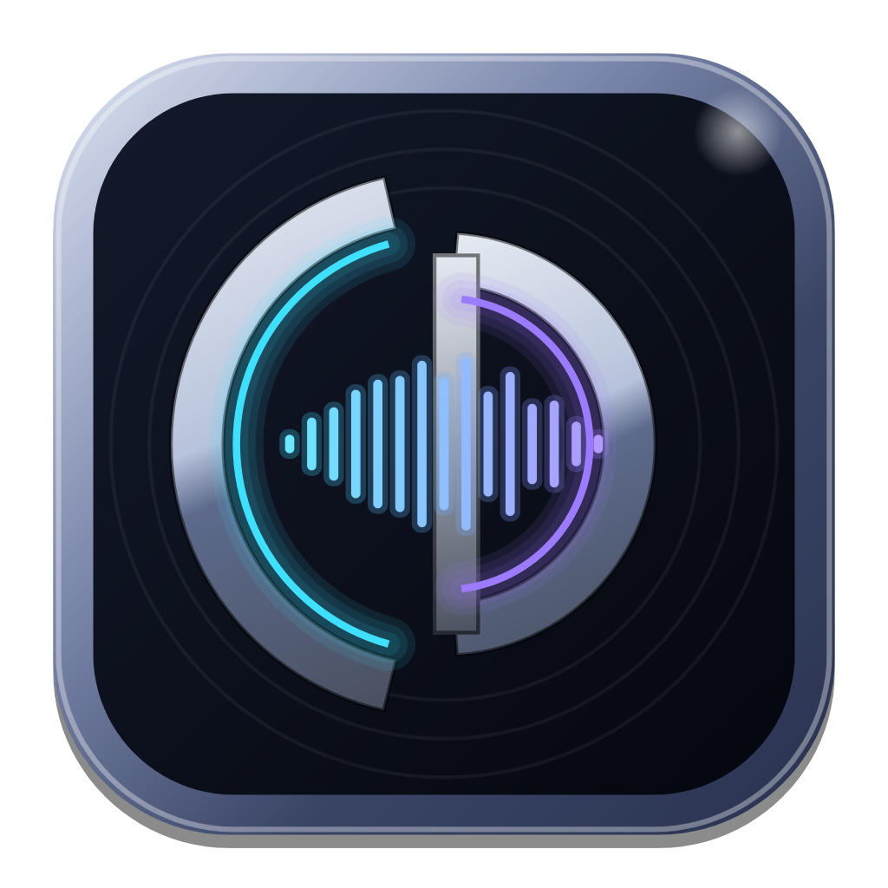

<p align="center"></p>

# Croft DAW

A personal recording DAW for tracking guitars, bass and drums. It has about 20 tracks, VST3/AU plugins,
EZdrummer on an instrument track, a full mixer with sends and buses, take comping, fades, and one-click
**stem export** so you can mix in Logic or Reaper.

Built with C++20, [JUCE](https://juce.com) and [Tracktion Engine](https://github.com/Tracktion/tracktion_engine).
Runs on **macOS (Apple Silicon + Intel, universal binary)** and **Linux**.


## Features

**Recording**
- Per-track input selection, with each interface channel as its own mono input
- Record arm, and input monitoring through the track's plugins (hear your amp sim while you play)
- Click, count-in, loop recording, and recording latency compensation (handled by the engine)

**Take lanes & comping** (Logic/Pro Tools style)
- Recording over existing audio puts each pass on its own **take lane** under the track, which
  opens automatically. Loop recording gives one lane per loop pass. Loops must be longer than 2 seconds.
- The track plays the newest complete pass. **Swipe across any take lane** to use that take for that
  section; click a take to use it for the whole clip. The parts in use light up.
- The **T** button shows or hides a track's lanes. Right-click a lane to delete it, or keep the comp and
  delete all lanes.
- Comp edits get short 8 ms fades so they never click.

**Fades & crossfades**
- Drag the small chrome handles at the top corners of an audio clip to set its fade in/out
- Right-click a clip to choose the curve (linear, convex, concave, S-curve), apply quick 10 ms fades,
  or remove fades
- Overlapping clips crossfade automatically (toggle per clip)

**Mixer**
- Channel strips with input, insert slots (add, open, bypass, reorder, remove), sends, output routing,
  pan, fader, stereo meter, mute/solo/arm/monitor
- **Aux buses** (reverb, delay, parallel compression…): **+ Bus**, then **+ Send** on any channel.
  Sends are post-fader.
- **Group/submix buses**: set a channel's *Output* to a bus
- Master strip
- **Docked below the tracks** (drag the divider to resize), **popped out to its own window** for a
  second screen, or hidden. Use View > Mixer…, the Pop Out/Dock button, or the **X** / **Shift+X** keys.

**Plugins & EZdrummer**
- VST3 inserts (plus AU on Mac); scan via Plugins > Plugin Manager
- Track > New Instrument Track > EZdrummer, then drag grooves from EZdrummer onto the track lane
  (or drop any `.mid` file). Double-click an empty instrument lane to create a 4-bar MIDI clip.

**Editing**
- Move clips (snap to beat; hold Shift for free movement), split at playhead, delete, undo/redo
- Drag and drop audio/MIDI files onto lanes

**Export Stems**
- File > Export Stems writes one 24-bit WAV per recording track, **all starting at 0:00**, so they line
  up in Logic or Reaper. Track plugins are printed. Buses and sends aren't, since you'd rebuild those in
  your mix DAW.

**Look**
- Pro Tools / Logic / Reaper style arrange view in a "Midnight Chrome" theme. All colours are in
  [`Source/Theme.h`](Source/Theme.h); the logo and icon are drawn in [`Source/Logo.h`](Source/Logo.h).

## Download a build

Every push to `main` is built by GitHub Actions. Open the
[Actions tab](https://github.com/pjcroft/PC-DAW/actions), click the latest green run, and download from
*Artifacts*:

- **Croft-DAW-macOS-universal**: unzip it and move `Croft DAW.app` to Applications. The app isn't signed,
  so the first time, right-click it and choose **Open**. Or run:
  ```bash
  xattr -dr com.apple.quarantine "/Applications/Croft DAW.app"
  ```
- **Croft-DAW-linux-x86_64**: unpack it and run `./install.sh` to add Croft DAW (with its icon) to your
  applications menu

## Building from source

You need CMake 3.22+ and a C++20 compiler. The first configure downloads JUCE and Tracktion Engine (pinned
versions); the first build takes several minutes.

### macOS (universal: arm64 + x86_64)

Requires **Xcode 16 or newer** and macOS 12+ to run.

```bash
xcode-select --install          # if you don't have the command line tools
brew install cmake              # if you don't have CMake
git clone https://github.com/pjcroft/PC-DAW.git
cd PC-DAW
cmake -B build -DCMAKE_BUILD_TYPE=Release
cmake --build build --config Release -j8
open "build/CroftDAW_artefacts/Release/Croft DAW.app"
```

Prefer Xcode? `cmake -B build-xcode -G Xcode`, then open `build-xcode/CroftDAW.xcodeproj`.

The first time you record, macOS asks for microphone permission. Allow it, or inputs stay silent.

### Linux

```bash
# Debian/Ubuntu dependencies
sudo apt install build-essential cmake git pkg-config libasound2-dev libjack-jackd2-dev \
  libx11-dev libxrandr-dev libxinerama-dev libxcursor-dev libxext-dev libxcomposite-dev \
  libxi-dev libxrender-dev libfreetype-dev libfontconfig1-dev libgl1-mesa-dev

git clone https://github.com/pjcroft/PC-DAW.git
cd PC-DAW
cmake -B build -DCMAKE_BUILD_TYPE=Release
cmake --build build -j8
"./build/CroftDAW_artefacts/Release/Croft DAW"
```

Pick ALSA or JACK (PipeWire's JACK works) in File > Audio & MIDI Settings. Linux VST3s work; EZdrummer has
no native Linux build.

## First run

1. **File > Audio & MIDI Settings**: pick your interface, enable its inputs, and set the buffer size
   (64–128 samples for low-latency monitoring through amp sims)
2. **Plugins > Plugin Manager > Options > Scan for new or updated VST3 plug-ins** (and AudioUnits on Mac)
3. Pick an input on a track, press **R** to arm it, and press **Record**. Record again over the same bars
   for more takes, then swipe to comp.
4. **Track > New Instrument Track** and choose EZdrummer for drums
5. **+ Bus** in the mixer for a reverb, then **+ Send** on the channels you want in it
6. **File > Export Stems** when you're ready to mix

Sessions are saved in `~/Music/Croft DAW/<Session Name>/` with all takes alongside them.

## Keyboard shortcuts

| Key | Action |
|---|---|
| Space | Play / stop |
| R | Record |
| Enter / Home | Return to start |
| L | Loop on/off (drag in the ruler to set the loop range) |
| C | Click on/off |
| S | Split at playhead |
| X / Shift+X | Mixer below tracks on/off / mixer in its own window |
| Delete / Backspace | Delete selected clip |
| + / − | Zoom (Cmd/Ctrl + scroll also zooms; Shift + scroll scrolls sideways) |
| Cmd/Ctrl+Z, Cmd/Ctrl+Shift+Z | Undo / redo |
| Cmd/Ctrl+S, N, O, E, T, I | Save, new, open, export stems, new track, import |

## Developer options

```bash
"Croft DAW" --demo                             # open a generated demo session (no interface needed)
"Croft DAW" --demo --screenshot out.png        # write a screenshot and quit
"Croft DAW" --demo --mixer window --screenshot out.png   # also writes out-mixer.png
"Croft DAW" --demo --export-stems out/         # render the demo's stems and quit
"Croft DAW" --test-record                      # record/comp/loop-take self-test (needs an input, e.g. JACK)
"Croft DAW" --render-icon assets/icon.png      # regenerate the app icon from Source/Logo.h
```

CI runs the stem-export and recording tests on Linux against a virtual JACK device.

## Code layout

| File | What it does |
|---|---|
| `Source/Session.*` | Wraps a Tracktion `Edit`: tracks, inputs, plugins, buses & sends, take lanes & comping, import, stem export |
| `Source/TrackComponents.*` | Track header, timeline lane (clips, fades, take-lane swiping), ruler |
| `Source/MixerComponents.*` | Channel strips, bus strips, master, mixer panel |
| `Source/MainComponent.*` | Transport bar, arrange view, mixer docking/pop-out, menus, shortcuts |
| `Source/Theme.h` | Midnight Chrome colours + LookAndFeel |
| `Source/Logo.h` | Logo, badge and launcher icon artwork |
| `Source/PluginWindow.h` | Plugin editor windows and engine UI hooks |
| `Source/DemoContent.h` | Generated demo session |
| `packaging/linux/` | Desktop entry and installer |

## License

Tracktion Engine and JUCE are used under GPLv3, so this project is GPLv3 too. That's fine for personal
use and open source; selling a closed-source build would need commercial licenses.
