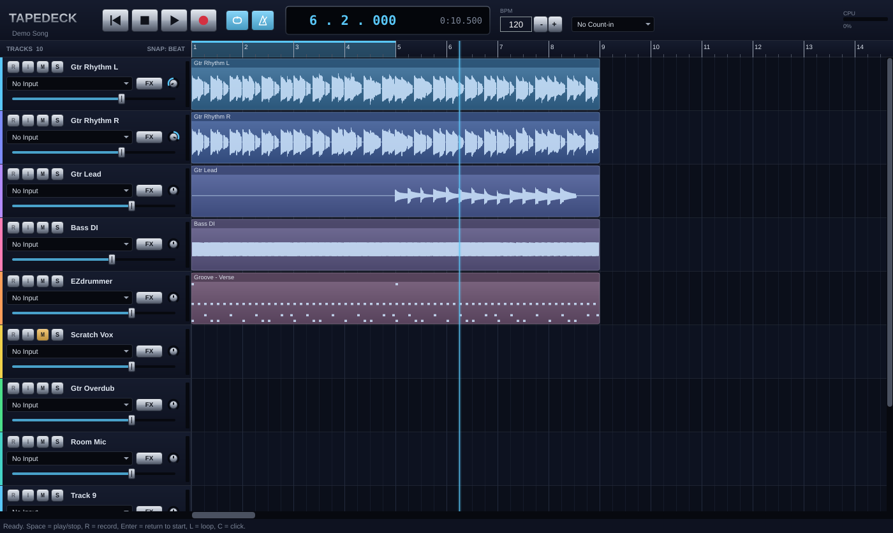

# Tapedeck

A personal recording DAW for tracking guitars, bass and drums: about 20 tracks, VST3/AU plugins,
EZdrummer as an instrument track, and one-click **stem export** so you can mix in Logic or Reaper.

Built with C++20, [JUCE](https://juce.com) and [Tracktion Engine](https://github.com/Tracktion/tracktion_engine).
Runs on **macOS (Apple Silicon + Intel, universal binary)** and **Linux**.



## Features

- **Recording**: per-track input selection (each interface channel is a mono input), record arm,
  input monitoring through the track's plugins (hear your amp sim while you play), count-in, click,
  loop recording, recording latency compensation (handled by the engine)
- **Plugins**: VST3 (+ AU on Mac) inserts per track, plugin windows, bypass/reorder/remove,
  plugin scanner (Plugins > Plugin Manager)
- **EZdrummer / instrument tracks**: Track > New Instrument Track, then drag grooves from
  EZdrummer's browser onto the track lane (or drop any `.mid` file). Double-click an empty spot on
  an instrument lane to create an empty 4-bar MIDI clip. A MIDI keyboard/pad is routed to it automatically.
- **Editing**: move clips (snap to beat; hold Shift for free), split at playhead, delete, undo/redo,
  drag-and-drop audio/MIDI files onto lanes
- **Mixer basics**: volume, pan, mute, solo, stereo meters per track
- **Export stems**: File > Export Stems writes one 24-bit WAV per track, **all starting at 0:00**, so they
  line up when dropped into Logic/Reaper. Plugins are printed; the master bus isn't.
- **Look**: Pro Tools / Logic / Reaper style arrange view in a "Midnight Chrome" theme. All colours live in
  [`Source/Theme.h`](Source/Theme.h).

## Building

You need CMake 3.22+ and a C++20 compiler. The first configure downloads JUCE and Tracktion Engine
(pinned versions), and the first build takes a few minutes.

### macOS (universal: arm64 + x86_64)

```bash
xcode-select --install          # if you don't have the command line tools
brew install cmake              # if you don't have CMake
git clone https://github.com/pjcroft/PC-DAW.git
cd PC-DAW
cmake -B build -DCMAKE_BUILD_TYPE=Release
cmake --build build --config Release -j8
open build/Tapedeck_artefacts/Release/Tapedeck.app
```

Prefer Xcode? `cmake -B build-xcode -G Xcode`, then open `build-xcode/Tapedeck.xcodeproj`.

The first time you record, macOS asks for microphone permission. Allow it, or inputs stay silent.
Because the app isn't signed, the first launch may need right-click > **Open**.

### Linux

```bash
# Debian/Ubuntu dependencies
sudo apt install build-essential cmake git pkg-config libasound2-dev libjack-jackd2-dev \
  libx11-dev libxrandr-dev libxinerama-dev libxcursor-dev libxext-dev libxcomposite-dev \
  libxi-dev libxrender-dev libfreetype-dev libfontconfig1-dev libgl1-mesa-dev

git clone https://github.com/pjcroft/PC-DAW.git
cd PC-DAW
cmake -B build -DCMAKE_BUILD_TYPE=Release
cmake --build build -j8
./build/Tapedeck_artefacts/Release/Tapedeck
```

On Linux, pick ALSA or JACK (PipeWire's JACK works) in File > Audio & MIDI Settings. Linux VST3s
work. EZdrummer has no native Linux build.

## First run

1. **File > Audio & MIDI Settings**: pick your interface, enable its inputs, and set the buffer size
   (64–128 samples for low-latency monitoring through amp sims).
2. **Plugins > Plugin Manager > Options > Scan for new or updated VST3 plug-ins** (and AudioUnits on Mac).
   EZdrummer and big amp-sim suites can take a while to scan.
3. Pick an input for each track (Input 1 → Track 1 is set up automatically), press **R** on a track to
   arm it, and press **Record**.
4. **Track > New Instrument Track** and choose EZdrummer for drums.
5. **File > Export Stems** when you're ready to mix.

Sessions are saved in `~/Music/Tapedeck/<Session Name>/`, with recorded takes alongside them.

## Keyboard shortcuts

| Key | Action |
|---|---|
| Space | Play / stop |
| R | Record |
| Enter / Home | Return to start |
| L | Loop on/off (drag in the ruler to set the loop range) |
| C | Click on/off |
| S | Split at playhead |
| Delete / Backspace | Delete selected clip |
| + / − | Zoom (Cmd/Ctrl + scroll also zooms; Shift + scroll scrolls sideways) |
| Cmd/Ctrl+Z, Cmd/Ctrl+Shift+Z | Undo / redo |
| Cmd/Ctrl+S, N, O, E, T, I | Save, new, open, export stems, new track, import |

## Developer options

```bash
Tapedeck --demo                       # opens a generated demo session (no interface needed)
Tapedeck --demo --screenshot out.png  # writes a screenshot and quits
Tapedeck --demo --export-stems out/   # renders the demo's stems and quits
```

## Code layout

| File | What it does |
|---|---|
| `Source/Session.*` | Wraps a Tracktion `Edit`: tracks, input routing, arming, plugins, import, stem export |
| `Source/TrackComponents.*` | Track header (arm/monitor/mute/solo/input/FX/vol/pan/meter), timeline lane, ruler |
| `Source/MainComponent.*` | Transport bar, arrange view, menus, keyboard shortcuts |
| `Source/Theme.h` | Midnight Chrome colours + LookAndFeel |
| `Source/PluginWindow.h` | Plugin editor windows |
| `Source/DemoContent.h` | Generated demo session |

## Roadmap ideas

- Mixer window, sends and buses
- Takes/comping lanes, fades and crossfades
- Waveform zoom and track height control
- MIDI editing (piano roll / drum grid)
- Markers and tempo map editing

## License

Tracktion Engine and JUCE are used under GPLv3, so this project is GPLv3 too. That's fine for
personal use and open source. Selling a closed-source build would need commercial licenses.
